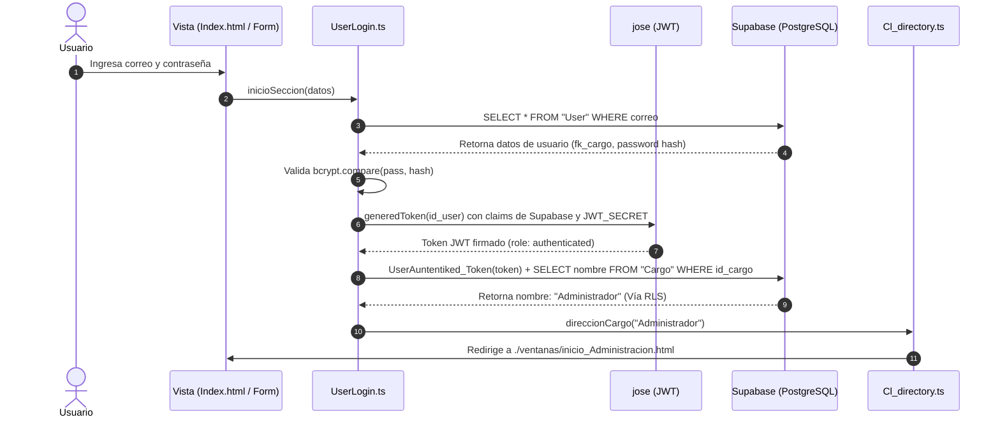

# 🏀 Guía de Aprendizaje: Autenticación, JWT Custom con Supabase y Redirección en TypeScript

Este documento resume las causas, diagnósticos y soluciones aplicadas durante la resolución del flujo de login, consulta de roles por ID y redirección de usuarios en **HoopPeru WEB**.

---

## 🧭 1. Resumen del Flujo de Datos



---

## 🔍 2. Problemas Detectados y Lecciones Aprendidas

### ⚠️ Problema 1: Nombres de atributos en la Base de Datos (`fk_cargo` vs `cargo`)
* **Qué pasaba:** En `UserLogin.ts` se evaluaba `usuario?.cargo`. Como la columna en PostgreSQL se llama `fk_cargo`, la expresión resultaba `undefined`.
* **Consecuencia:** La condición ternaria nunca invocaba la búsqueda del cargo y asignaba el valor por defecto `"otro"`.
* **Lección:** Siempre valida los nombres exactos de las columnas devueltas por la base de datos antes de acceder a sus propiedades en TypeScript.

```typescript
// ❌ Antes:
const Name_cargo = usuario?.cargo ? await this.SupBuscador_ID.BusquedaRedireccion("cargo", ID) : "otro";

// ✅ Ahora:
const ID = usuario.fk_cargo;
const Name_cargo = await this.SupBuscador_ID.BusquedaRedireccion("cargo", ID);
```

---

### ⚠️ Problema 2: El Token JWT no era aceptado por Supabase
* **Qué pasaba:** El token se firmaba localmente con una clave arbitraria (`"duval"`) y sin los campos estándar que PostgreSQL/PostgREST requieren.
* **Consecuencia:** Supabase rechazaba la autenticación y trataba las consultas como un usuario anónimo sin permisos (`Error 42501: permission denied`).
* **Lección:** Para que Supabase acepte un token personalizado generado con `jose`, deben cumplirse dos requisitos:
  1. **Firma:** Debe firmarse con el **JWT Secret oficial** del proyecto Supabase (`Project Settings -> API -> JWT Secret`).
  2. **Claims obligatorios en el Payload:**
     * `sub`: El ID del usuario.
     * `role`: `"authenticated"`.
     * `aud`: `"authenticated"`.

```typescript
// ✅ Firma correcta para Supabase con jose:
const secret = new TextEncoder().encode(jwtSecret);
return await new jose.SignJWT({
    sub: userID,
    role: "authenticated",
    aud: "authenticated",
    status: true
})
.setProtectedHeader({ alg: "HS256" })
.setIssuedAt()
.setExpirationTime("2d")
.sign(secret);
```

---

### ⚠️ Problema 3: Políticas de Seguridad en Supabase (RLS - Row Level Security)
* **Qué pasaba:** Por defecto, una tabla en PostgreSQL con RLS bloquea cualquier consulta que no tenga una política explícita.
* **Consecuencia:** Aunque el usuario enviara el token con rol `authenticated`, la tabla `Cargo` no tenía una política `SELECT` activa.
* **Lección:** En Supabase, cada tabla consultada por el cliente necesita su política RLS.
  ```sql
  ALTER TABLE public."Cargo" ENABLE ROW LEVEL SECURITY;

  CREATE POLICY "Permitir lectura de Cargo a usuarios autenticados" 
  ON public."Cargo" 
  FOR SELECT 
  TO authenticated 
  USING (true);
  ```

---

### ⚠️ Problema 4: Rutas Relativas y Nombres de Archivo
* **Qué pasaba:** 
  1. La ruta en `Cl_directory.ts` usaba `../../ventanas/`, lo cual se salía de la raíz del servidor web al navegar desde `Index.html`.
  2. El nombre del archivo en disco era `inicio_Administracion.html`, pero en el código se referenciaba como `inicio_Administrativo.html`.
* **Lección:** En aplicaciones web estáticas / SPA, las rutas relativas desde la raíz deben comenzar con `./` o `/`, y el nombre del archivo debe coincidir exactamente con el sistema de archivos.

```typescript
// ❌ Antes:
window.location.href = "../../ventanas/inicio_Administrativo.html";

// ✅ Ahora:
window.location.href = "./ventanas/inicio_Administracion.html";
```

---

## 🛠️ 3. Resumen de Archivos Modificados

| Archivo | Cambio Principal |
| :--- | :--- |
| [.env](file:///c:/Users/DuvalP/OneDrive/Desktop/HoopPeru%20WEB/.env) | Se configuró el `JWT_SECRET` oficial de Supabase. |
| [build.js](file:///c:/Users/DuvalP/OneDrive/Desktop/HoopPeru%20WEB/build.js) | Se agregó la variable `process.env.JWT_SECRET` en `define` para inyectarla en el bundle. |
| [Cl_Utils.ts](file:///c:/Users/DuvalP/OneDrive/Desktop/HoopPeru%20WEB/src/models/Utils/Cl_Utils.ts) | Se configuró la firma JWT con `jose` incluyendo los claims `sub`, `role: "authenticated"` y `aud`. |
| [UserLogin.ts](file:///c:/Users/DuvalP/OneDrive/Desktop/HoopPeru%20WEB/src/modules/User_Moduls/UserLogin.ts) | Se corrigió el uso de `usuario.fk_cargo` para la búsqueda en la tabla `Cargo`. |
| [Cl_directory.ts](file:///c:/Users/DuvalP/OneDrive/Desktop/HoopPeru%20WEB/src/config/Cl_directory.ts) | Se normalizó la comparación del cargo y se corrigió la ruta de redirección a `./ventanas/inicio_Administracion.html`. |
