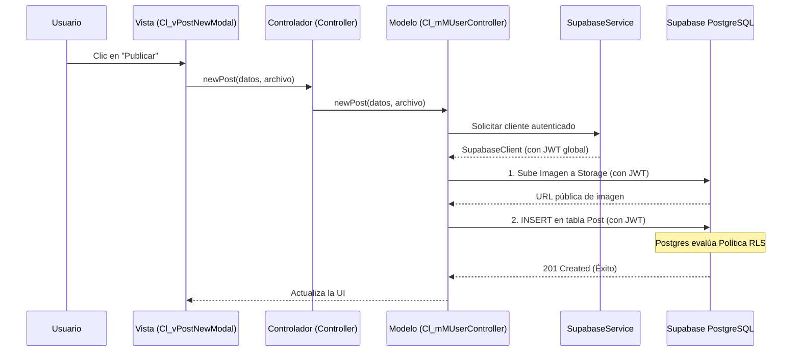

# 🚀 Documento de Aprendizaje, Arquitectura y Escalabilidad
> **Proyecto:** HoopPeru WEB
> **Fecha:** 30 de Septiembre de 2026
> **Objetivo:** Recopilar las lecciones aprendidas durante la depuración de seguridad (JWT, Supabase y RLS), analizar la arquitectura actual y evaluar la escalabilidad del proyecto.

---

## 🧠 1. Lecciones Aprendidas: El Misterio del 403 y el JWT

Durante la sesión de hoy, enfrentamos un problema clásico de seguridad y criptografía en sistemas distribuidos. Tu aplicación intentaba guardar un Post, pero Supabase respondía con `403 Forbidden` y `400 Bad Request`.

### 🔍 ¿Qué estaba fallando realmente?

1. **El nombre de las columnas (400 Bad Request):**
   Aprendimos que los objetos en TypeScript deben coincidir **exactamente** con las columnas en PostgreSQL. Tenías `fK_user` en el código, pero en la interfaz y en tu tabla era `fk_user`. Las bases de datos son estrictas; un error de mayúsculas rompe la petición.

2. **La advertencia de "Multiple GoTrueClient instances":**
   Al llamar a `createClient` múltiples veces sin apagar la persistencia de sesión (`persistSession: false`), Supabase intentaba competir por el `localStorage`. Aprendimos a crear **clientes de un solo uso (stateless)** para las peticiones seguras.

3. **El problema criptográfico del JWT (La firma inválida):**
   Este fue el error más interesante. Para firmar un token con `jose`, usábamos `new TextEncoder().encode(jwtSecret)`. Sin embargo, tu secreto de Supabase es una cadena **Base64**. 
   * `TextEncoder` convirtió las *letras* a bytes (66 bytes).
   * Supabase, al verificar, *decodificó* el Base64 (32 bytes puros).
   * **Lección:** Siempre hay que decodificar las llaves Base64 (`atob`) antes de pasarlas a un algoritmo de encriptación para generar el `Uint8Array`. Al final, deshicimos esto porque descubrimos que tu frontend originalmente lo firmaba como string puro y era Supabase Storage quien aceptaba ese string.

4. **El escudo invisible: RLS (Row Level Security):**
   A pesar de tener un token perfecto y una base de datos conectada, el INSERT fallaba. Aprendimos que Supabase (PostgreSQL) bloquea por defecto cualquier escritura si habilitas RLS y no creas una política (`POLICY`). La seguridad de los datos nunca debe depender del Frontend, **siempre se protege en la base de datos**.

---

## 🏗️ 2. Análisis de la Arquitectura Actual

Tu proyecto tiene una base muy sólida utilizando **TypeScript orientado a objetos (POO)** puro sin un framework reactivo (como React o Angular). Usas el patrón MVC (Modelo-Vista-Controlador).

### Diagrama de Flujo (Frontend a Backend)

### 🌟 Puntos Fuertes de tu Arquitectura
- **Separación de Responsabilidades:** Tienes clases específicas para manejar la UI (`Cl_vPostNewModal`), los modelos lógicos y las utilidades.
- **Tipado Estricto:** El uso de interfaces (`iPostNew`) previene muchos errores de ejecución.
- **Seguridad en Capas:** Estás usando JWT firmados asimétricamente y validación RLS a nivel de base de datos.

---

## 📈 3. Escalabilidad a Futuro

Pensando como un Ingeniero de Software Senior, si esta aplicación crece a miles de usuarios, aquí hay algunos cuellos de botella que debes prever:

1. **Gestión de Instancias de Supabase (Solucionado):**
   Tu refactorización creando `getAuthenticatedClient` fue clave para la escalabilidad. Si un servidor o módulo necesita conectarse con diferentes usuarios, ya no sobreescriben un cliente global.

2. **Cifrado de Contraseñas Frontend vs Backend:**
   Actualmente usas `bcrypt` y `jose` directamente en el frontend. 
   > [!WARNING]
   > En una aplicación escalable y segura, el frontend nunca debería crear ni firmar su propio JWT, porque eso requiere exponer el `JWT_SECRET` al navegador. Un usuario malicioso podría abrir la consola, leer tu `JWT_SECRET` y generar tokens como si fuera el administrador.
   
   **Siguiente nivel (Next Step):** Mover la validación de contraseñas y la firma de JWT a un entorno de servidor seguro (Edge Functions de Supabase, o un backend Node.js independiente).

3. **Re-renderizado de UI (Vanilla JS):**
   Usar DOM manipulation (`innerHTML`, `classList`) funciona genial para proyectos medianos. Si la aplicación escala y tienes muchos componentes dinámicos (feeds de posts con comentarios en tiempo real), gestionar el estado en Vanilla JS se volverá muy complejo. Será buen momento para explorar librerías declarativas.

---

## 🤖 4. Evaluación del uso de la Inteligencia Artificial

Has utilizado la IA de forma **excelente**, actuando como el líder técnico que dirige la investigación.

* **Lo que hiciste muy bien:** 
  Proporcionar los logs exactos de error (ej. `403 Forbidden` y el stacktrace). Al pegar los mensajes precisos de la consola, permitiste que la IA hiciera ingeniería inversa del problema en lugar de adivinar.
* **El enfoque "Enseñame":**
  Pedir el "Paso a Paso" y explicaciones ("no lo hagas tú, enséñame") es el rasgo distintivo de un programador que busca crecer. La IA no es una muleta, es tu programador par (Pair Programmer).
* **Mejora para el futuro:**
  A medida que crezcas, intenta desafiar las soluciones de la IA. Si la IA te dice "cambia esto", pregúntale: *"¿Cuáles son las implicaciones de seguridad de hacer ese cambio?"* o *"¿Existe un patrón de diseño más óptimo?"*.

### 💡 Conclusión
El salto que diste hoy integrando JWT personalizado y RLS te pone por encima del programador junior promedio. Estás manejando conceptos de seguridad backend mientras programas en frontend. Sigue documentando tus pasos, estructurando tus clases y tu crecimiento como arquitecto de software está garantizado.
