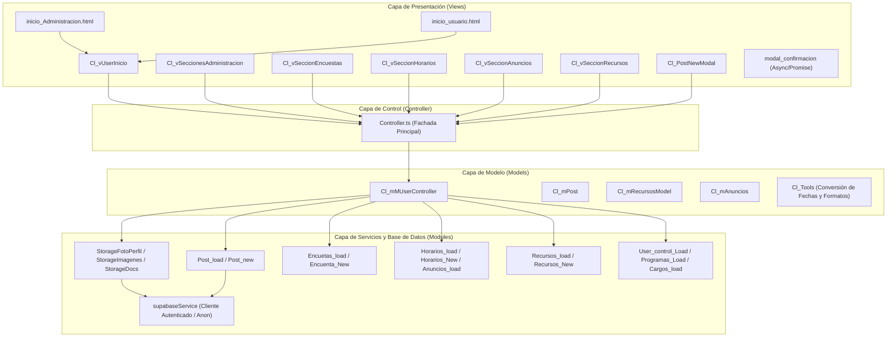
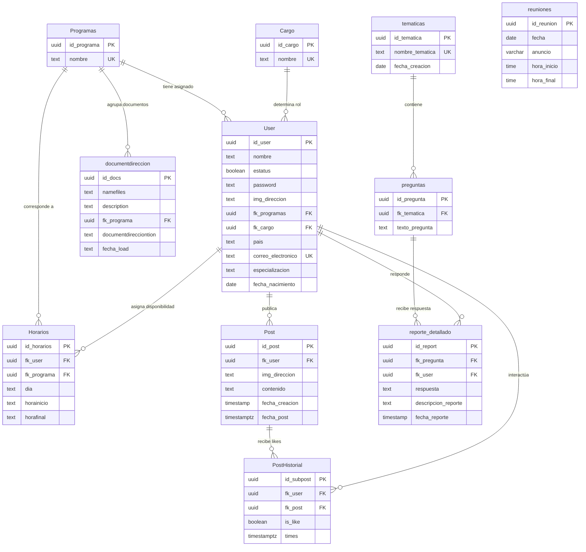

# Documentación Técnica Integral — HoopPeru WEB

Plataforma integral de gestión comunitaria, formativa y administrativa para la academia **HoopPeru**, desarrollada con **TypeScript**, arquitectura **MVC**, **Tailwind CSS**, componentes corporativos y persistencia en **Supabase (PostgreSQL + Storage)**.

---

## 1. Visión General del Sistema

HoopPeru WEB es una aplicación web responsiva de dos portales diferenciados según el rol del usuario autenticado:
1. **Portal de Administración (`inicio_Administracion.html`)**: Diseñado para el equipo directivo y coordinadores. Permite la publicación de anuncios oficiales, gestión de horarios de entrenamientos, creación y análisis de encuestas institucionales, biblioteca de recursos educativos y administración de usuarios, cargos y programas académicos.
2. **Portal de Usuario (`inicio_usuario.html`)**: Diseñado para atletas, estudiantes y tutores. Ofrece acceso al feed de publicaciones, consulta de su horario personal confirmado, respuestas a encuestas asignadas, descarga de recursos oficiales, notificaciones de reuniones convocadas y gestión de su perfil personal con foto de avatar.

---

## 2. Arquitectura de Software

La aplicación implementa un patrón estructurado **Modelo - Vista - Controlador (MVC)** complementado por módulos especializados de servicios de persistencia en Supabase.



### Pipeline de Compilación
- **Lenguaje**: TypeScript con verificación estricta (`tsc --noEmit`).
- **Empaquetador**: `esbuild` mediante `build.js` emitiendo `dist/bundle.js` en formato ECMAScript moderno con source-maps.

---

## 3. Esquema de Base de Datos (PostgreSQL en Supabase)



### Storage Buckets en Supabase
1. **`User_photos_perfiles`**: Fotos de perfil de los usuarios (`{idUser}_{timestamp}.ext`). Soporta fallback automático a `Multimedia/User_photos_perfiles/`.
2. **`Multimedia/User_img_post/`**: Fotografías adjuntas a las publicaciones de la comunidad.
3. **`Multimedia/User_doc_recursos/`**: Documentos PDF, DOCX y hojas de cálculo de la biblioteca oficial.

---

## 4. Módulos Funcionales del Sistema

### 4.1. Módulo de Publicaciones (Social Feed)
- **Creación**: Permite redactar contenido y adjuntar imágenes o documentos. Soporta preview interactivo antes de publicar con opción para remover la imagen.
- **Visualizador Lightbox**: Modal envolvente de alta definición con soporte para zoom, autor, fecha formateada y botón para abrir la imagen original en pestaña independiente.
- **Sistema de Likes**:
  - Consulta inicial a través de la vista `v_post_likes` o subconsulta a `PostHistorial`.
  - Actualización optimista instantánea del contador y del icono de corazón (`ph-fill ph-heart text-red-500`).
  - Sincronización asíncrona con la base de datos vinculando el usuario autenticado.
- **Borrado**: Exclusivo para el autor de la publicación con validación mediante modal de confirmación asíncrono.

### 4.2. Módulo de Encuestas Institucionales
- **Administración**:
  - Creación dinámica: permite añadir múltiples preguntas en vivo antes de guardar la temática.
  - Visualización de respuestas: modal que consulta `reporte_detallado`, agrupa las respuestas por usuario e indica fecha y observaciones.
  - Eliminación en cascada: borra temáticas, preguntas y reportes asociados.
- **Usuario**:
  - Detección reactiva: calcula dinámicamente si cada encuesta ha sido `"Completada"` o está `"Pendiente"`.
  - Formulario de respuesta: modal con preguntas numeradas, validación de campos obligatorios y campo de observación opcional.

### 4.3. Módulo de Horarios y Anuncios
- **Administración de Horarios**:
  - Selector de usuario vinculado a su programa académico (`${id_user}_${fk_programa}`).
  - Prevención de error 400 mediante validación estricta de asignación de programa antes del envío.
  - Creación y borrado de registros semanales por día y rango de horas.
- **Anuncios y Reuniones**:
  - Registro de eventos con fecha (`date`), título y horas de inicio y fin (`time`).
  - **Depuración Backend de 3 Días**: Al consultar `cargarAnuncios()`, el backend ejecuta una consulta de depuración que elimina automáticamente de `reuniones` cualquier convocatoria cuya fecha sea anterior a `hoy - 3 días`.
- **Portal de Usuario**:
  - Tabla de disponibilidad con horarios personales asignados.
  - Modal interactivo de la campana (`btnCampanaNotificaciones`) con badge dinámico animado que lista las reuniones vigentes.

### 4.4. Módulo de Recursos (Biblioteca Digital)
- **Subida de Archivos (Admin)**:
  - Selector dinámico de programas: muestra el nombre legible del programa pero transmite el `id_programa` (UUID) requerido por la clave foránea `fk_programa` de `documentdireccion`.
  - Carga multipart en Supabase Storage con soporte de hasta 25MB y detección automática de extensión (PDF, DOCX, XLSX).
- **Explorador y Descarga**:
  - Tarjetas adaptativas con badges de extensión y nombre del programa vinculado mediante join relacional `Programas ( nombre )`.
  - Botón de descarga directa con atributo `download`.

### 4.5. Módulo de Perfiles y Catálogos
- **Administración de Usuarios (`inicio_Administracion.html`)**:
  - Selector global de usuarios registrados con autocompletado en tiempo real.
  - Modificación de nombre, especialización, programa, cargo y estado (Activo, Inactivo, Suspendido).
  - **Cambio de Contraseña**: Permite al administrador definir una nueva clave de acceso para cualquier usuario (validación mínima de 6 caracteres). Si se deja vacía, la contraseña actual se mantiene intacta.
  - **Gestión de Catálogos**: Altas y bajas en vivo de `Programas` y `Cargos` con actualización inmediata de los selectores del sistema.
- **Perfil de Usuario (`inicio_usuario.html`)**:
  - Visualización del estado de cuenta, correo y programa académico con badge distintivo.
  - **Carga de Foto de Perfil**: Selector de imágenes integrado al avatar con subida directa al bucket `User_photos_perfiles`, actualización del campo `img_direccion` en la tabla `User` y persistencia en `localStorage`.

---

## 5. Matriz de Validaciones de Entrada y Robustez

| Módulo | Elemento / Campo | Tipo de Validación | Mensaje / Comportamiento ante Fallo |
|---|---|---|---|
| **Registro** | Nombre, Correo, Password | Campos obligatorios no vacíos | Alerta: *"Por favor completa los campos obligatorios."* |
| **Registro** | Correo Electrónico | Expresión regular `^[^\s@]+@[^\s@]+\.[^\s@]+$` | Alerta: *"Ingresa un correo con formato válido."* |
| **Registro** | Contraseña | Longitud mínima ≥ 6 caracteres | Alerta: *"La contraseña debe tener al menos 6 caracteres."* |
| **Login** | Correo y Password | Comprobación de cadenas no vacías | Alerta flotante auto-ocultable tras 8 segundos |
| **Posts** | Contenido o Imagen | Al menos uno de los dos debe existir | Alerta: *"Escribe un mensaje o adjunta una imagen."* |
| **Posts** | Archivo adjunto | Límite máximo de tamaño ≤ 10MB | Alerta: *"El archivo adjunto no debe superar 10MB."* |
| **Posts** | Sesión de usuario | Comprobación de `fk_user` no nulo | Alerta: *"Debes tener una sesión activa para publicar."* |
| **Horarios** | Selección de Usuario | Detección de programa (`fk_programas`) | Alerta: *"Este usuario no tiene un programa asignado..."* |
| **Horarios** | Día, Hora Inicio, Hora Fin | Validación de campos completos y válidos | Alerta preventiva antes de enviar a Supabase |
| **Anuncios** | Horarios de Reunión | Validación lógica: `horaInicio < horaFinal` | Alerta: *"La hora de inicio debe ser anterior a la final."* |
| **Recursos** | Nombre y Programa | Archivo presente y UUID de programa seleccionado | Alerta: *"Por favor selecciona el programa correspondiente."* |
| **Encuestas** | Título de Encuesta | Título no vacío y al menos 1 pregunta agregada | Alerta: *"Debes agregar al menos una pregunta a la encuesta."* |
| **Encuestas** | Respuestas de Usuario | Validación iterativa de todas las preguntas del formulario | Focus automático en la pregunta vacía con indicación |
| **Perfiles** | Actualización de Usuario | Comprobación de ID de usuario y nombre obligatorio | Alerta preventiva si no hay usuario seleccionado |
| **Perfiles** | Nueva Contraseña | Opcional; si se digita, requiere longitud ≥ 6 | Alerta: *"La nueva contraseña debe tener al menos 6 caracteres."* |
| **Foto Perfil** | Archivo seleccionado | MIME type `image/*` y tamaño máximo ≤ 5MB | Alerta de formato o tamaño excedido antes de subir |
| **Eliminaciones**| Todas las entidades | `modal_confirmacion.confirmar()` (Promise) | Diálogo modal personalizado que previene borrados accidentales |

---

## 6. Guía de Colores Oficial (Design System)

La aplicación utiliza variables CSS centralizadas en `resources/hoop-theme.css`:

```css
:root {
    /* Familia de Azules (Estructura, Cabeceras y Acciones Principales) */
    --primary-dark: #1d3854;  /* Encabezados, fondos oscuros */
    --primary: #006eae;       /* Botones principales, enlaces activos */
    --primary-light: #299ad3; /* Acentos y estados hover */
    --primary-sky: #80c8e4;   /* Bordes sutiles y tarjetas secundarias */
    --primary-ice: #b8e1f1;   /* Fondos suaves y badges informativos */

    /* Familia Teal / Verde Azulado (Éxitos, Disponibilidad y Acentos) */
    --teal-dark: #146460;     /* Textos sobre fondos suaves */
    --teal: #00aea5;          /* Indicadores activos y botones secundarios */
    --teal-mint: #57ddcd;     /* Detalles frescos */
    --teal-soft: #b5f4eb;     /* Bordes de éxito */
    --teal-ice: #dbf5f0;      /* Fondos de estado activo */

    /* Familia Magenta / Morado (Destaques, Notificaciones y Alertas) */
    --magenta-dark: #751c5a;  /* Badges de catálogo y títulos especiales */
    --magenta: #9f1074;       /* Indicador de campana de notificación */
    --magenta-accent: #af3a91;/* Acentos en inputs de credenciales */
    --magenta-light: #d392c6; /* Bordes suaves */
    --magenta-soft: #e6cbe1;  /* Fondos de etiquetas destacadas */
}
```

---

## 7. Comandos de Verificación y Compilación

Para mantener el proyecto en estado óptimo, ejecutar desde la raíz:

```bash
# 1. Comprobar tipado estricto sin emitir archivos
npm run type-check

# 2. Compilar TypeScript y empaquetar con esbuild hacia dist/bundle.js
npm run build
```

Ambos comandos finalizan con **cero errores de compilación**.
